# RESPOSTAS — ICEIBank (Sprints 1, 2 e 3)

**Aluno:** gabriel silveira · RA 1466316
**Disciplina:** Lab. de Desenvolvimento de Aplicações Móveis e Distribuídas — U2
**Linguagem:** Java 21 + Spring Boot 3.5.16 (Maven)
**Arquitetura:** MVC — `controle` (rotas/DTOs) · `servico` (regras de aplicação) · `modelo` (regras de negócio) · `repositorio` (persistência)

---

## Parte B — Relógio de Lamport (6.4)

### 6.4.1 — Por que `max(local, recebido) + 1` em vez de adotar o timestamp recebido?

Para proteger a ordem dos processos: a agência pode receber um 7 já tendo carimbado um evento com 7 — e o envio *causou* o recebimento. Cada metade da fórmula protege uma coisa:

- **`max` protege a ordem LOCAL.** Estando em 10, adotar o 3 recebido faria o próximo evento carimbar 4 — mas 4…10 já foram emitidos. O relógio teria retrocedido, e relógio lógico nunca anda para trás. → teste `aoReceberCarimboMenorNaoRetrocede` (10 recebe 3 → 11).
- **`+ 1` protege a ordem CAUSAL.** Sem ele, envio e recebimento teriam o mesmo carimbo. Carimbo igual significa "não sei ordenar" — falso aqui. → teste `aoReceberCarimboIgualDesempata` (5 recebe 5 → 6).

Verificado por **mutação manual**: sem o `Math.max`, o teste do caso menor fica vermelho; sem o `+ 1`, os três testes de `aoReceber` ficam vermelhos.

### 6.4.2 — Contador em 10 recebendo timestamp 3: novo valor? Agências rápidas x lentas?

**11** — o local é maior, o `max` protege.

Agência **rápida** ignora carimbos baixos (em 10, recebendo 3, avança só para 11): vizinho lento não a atrasa. Agência **lenta** salta (em 2, recebendo 7, pula para 8). Cada relógio anda no ritmo do **vizinho mais rápido com quem se comunica** — o contador não mede tempo nem trabalho, mede **posição na cadeia causal**.

**Concorrência:** `eventoLocalEhSeguroSobConcorrencia` (100 threads) expôs corrida real — `contador++` não é atômico e duas threads produziram o mesmo carimbo (`expected: <100> but was: <99>`). Corrigido com `synchronized`. O `aoReceber()` tem a mesma corrida e foi protegido **por inspeção**, sem teste dedicado.

---

## Parte D — Transferências (8.3)

### 8.3.1 — Por que a transferência local dispensa `aoEnviar()`/`aoReceber()`?

Porque as regras 2 e 3 existem **para sincronizar relógios diferentes**, e na local só existe **um** relógio: débito e crédito acontecem no mesmo processo, sobre o mesmo contador, e dois `eventoLocal()` sucessivos já bastam (teste `geraDoisEventosLocais`). Usar `aoEnviar`/`aoReceber` ali seria fingir uma mensagem que nunca existiu.

Entre agências há **mensagem real**: a origem faz `aoEnviar()` e anexa o carimbo; o destino faz `aoReceber(carimbo)` em `/creditar-remoto`. É esse par que propaga o "aconteceu-antes" entre processos.

**Evidência — local** (`evidencias/sprint1/transferencia-local.png`): transferência de R$ 100 da conta 0 para a 3, ambas na agência 0. Dois eventos locais, carimbos **3** e **4**, com a *mesma* `horaParede` — nenhuma mensagem foi trocada.

**Evidência — entre agências** (`evidencias/sprint1/transferencia-entre-agencias.png`): transferência de R$ 50 da conta 0 para a 1. Débito na agência 0 com carimbo **7**; o `aoEnviar()` consumiu o **8**; a agência 1, que estava em **2** (os dois `CRIAR_CONTA` do boot), registrou o crédito remoto com **9 = max(2, 8) + 1**. O salto de 2 para 9 é a causalidade viajando pela rede.

### 8.3.2 — O saldo da origem foi revertido? O que significa?

**Não foi.** Reprodução (`evidencias/sprint1/falha-conhecida.png`): saldo da conta 0 em **R$ 750,00**, agência 1 derrubada (porta 4017, PID 22968), transferência de R$ 20 → **HTTP 502**, saldo depois **R$ 730,00**.

```
TRANSFERENCIA_DEBITO   Lamport  9   {valor:20.00, idOrigem:0, idDestino:1}
TRANSFERENCIA_FALHOU   Lamport 11   {erro:"Connection refused", saldoOrigemAposDebito:730.00}
```
O carimbo 10 foi consumido pelo `aoEnviar()` da mensagem que nunca chegou.

**Significa perda de atomicidade.** A transferência é logicamente uma operação, mas executa como duas escritas em processos diferentes sem nada garantindo "as duas ou nenhuma". Entre débito e crédito o dinheiro não está em conta nenhuma, e a soma dos saldos das três agências deixa de ser invariante — nenhuma agência sozinha percebe, porque cada uma só enxerga a própria partição.

A escolha foi **falhar de forma visível**: o 502 diz que o débito foi aplicado e não revertido, e `TRANSFERENCIA_FALHOU` grava o saldo pós-débito, deixando rastro para reconciliação.

### 8.3.3 — Duas formas de corrigir no Sprint 4

**1. Two-Phase Commit — atomicidade por bloqueio.** Um coordenador pergunta "consegue commitar?"; cada participante reserva recursos e responde sem efetivar; só com todos os "sim" vem o commit. *Custo:* bloqueante — se o coordenador cair após o prepare, os participantes ficam travados. Troca disponibilidade por consistência.

**2. Saga — atomicidade por compensação.** A transferência vira passos locais, cada um com transação compensatória. Débito e crédito commitam separados; falhando o crédito, dispara-se o estorno — operação de negócio nova, não rollback técnico. *Custo:* aceita inconsistência **temporária**, mas não bloqueia.

**Uma perda evitável, já corrigida:** transferir para uma conta que **não existe** no destino queimava o dinheiro igual à queda de agência, e ainda devolvia 502 ("agência indisponível") em vez de 404. Agora o destino é conferido antes do débito. A indisponibilidade continua sendo engolida nessa checagem **de propósito**: se a agência não responde, seguimos em frente para que a falha da Parte D aconteça no crédito, que é onde o roteiro manda registrá-la. O teste `agenciaForaDoArAindaDebitaSemReverter` existe só para impedir que essa checagem apague a Parte D.

**O código já ajuda:** a chamada remota está isolada em `AgenciaRemota`, então trocar o protocolo mexe numa classe só. E a **idempotência** já implementada é pré-requisito de Saga: passos compensatórios são reexecutados sob falha, e sem ela a retentativa aplicaria a operação duas vezes.

---

## Parte E — Linha do tempo unificada (10.3)

### 10.3.1 — Garante `A → B ⟹ ts(A) < ts(B)`, mas não a volta. E daí?

`ts(A) < ts(B)` **não permite concluir nada**: ou A causou B, ou os dois são **concorrentes** e os contadores só estavam nesses valores. Logo a linha do tempo do `--mesclar-logs` é uma ordenação **plausível**, não a real — nunca contradiz a causalidade, mas inventa ordem onde não existe.

O que se afirma com segurança é a **contrapositiva**: se `ts(A) >= ts(B)`, A definitivamente **não** causou B. Serve para excluir causalidade, não para provar.

### 10.3.2 — Lamport sozinho distingue concorrência de precedência? Por que o vetorial?

**Não.** Um único inteiro colapsa a história de todos os processos numa dimensão só, e nessa projeção perde-se "quem sabia de quem".

O vetorial guarda **um contador por processo**: cada agência mantém `[c0, c1, c2]`, incrementa a própria posição e, ao receber, faz o máximo **posição a posição**. A comparação passa a ter três resultados: `V(A) < V(B)` em tudo → A antes de B; o inverso → B antes de A; nenhum dos dois → **concorrentes, com certeza**.

Por isso `Comparable` seria a abstração errada para o carimbo: promete ordem **total**, e o vetorial só oferece ordem **parcial** — interface prometendo o que a implementação não cumpre viola Liskov. `Carimbo` nasceu sem `Comparable` já no Sprint 1.

### Observação do passo 3 (§10.2) — empates encontrados

`--mesclar-logs` achou **três** empates numa execução comum — 14 eventos, 3 agências
(`evidencias/sprint1/linha-do-tempo-part1.png` e `linha-do-tempo-part2.png`):

**Lamport 1** — os três `CRIAR_CONTA`: `agencia-0` (00:41:56.273), `agencia-1` (00:41:56.379) e `agencia-2` (00:41:56.432). **Concorrentes**: cada agência subiu e criou as próprias contas de demonstração sem trocar mensagem com ninguém.

**Lamport 2** — de novo os três `CRIAR_CONTA`: `agencia-0` (00:41:56.521), `agencia-1` (00:41:56.589) e `agencia-2` (00:41:56.611). Mesmo motivo: cada agência carrega **duas** contas no boot, então o segundo carimbo das três cai no mesmo valor.

**Lamport 9** — `agencia-1 TRANSFERENCIA_CREDITO_REMOTO` (00:48:26.844) e `agencia-0 TRANSFERENCIA_DEBITO` (00:49:00.222). Também **concorrentes**, e este é o caso interessante porque *parece* relacionado: o crédito remoto veio de uma transferência anterior (R$ 50, que deixou a conta 1 com R$ 850), e o débito é de outra, posterior (R$ 20) — justamente a que falhou, porque a agência 1 já tinha sido derrubada.

**O que o print do frontend mostra a mais.** Em `linha-do-tempo-front.png` a agência 1
aparece com `CRIAR_CONTA` carimbado **1** duas vezes — às 21:41:56 e de novo às 21:51:01 —
e o mesmo com o carimbo **2**. Não é concorrência: é a agência tendo sido **reiniciada**.
O `.jsonl` é aberto em `APPEND` e sobrevive ao restart, mas o contador vivia só em memória
e voltava a zero, então os carimbos recomeçavam sobre um log que já tinha carimbos maiores.
Um empate assim é **falso** — os dois eventos nem são concorrentes, são do mesmo processo,
em ordem. Corrigido: o relógio é restaurado do maior carimbo do arquivo ao subir
(`BeansDaAgencia.relogioLamport`), travado por `relogioRestauradoContinuaDeOndeOLogParou`.

**Contra a hora de parede:** a hora de parede *sugere* uma ordem no caso do Lamport 9 — o crédito às 00:48:26 antes do débito às 00:49:00 — mas o relógio de Lamport dá o **mesmo** carimbo aos dois, e é o Lamport que está certo: nenhum causou o outro. Aqui as 3 agências rodam na mesma máquina, com o mesmo relógio de hardware; em máquinas distintas a ordem física poderia até inverter sem nada estar errado. Por isso `horaParede` é gravado mas **nenhuma decisão do sistema o consulta**.

---

## Parte F — Autenticação JWT (11.3)

### Decisão: formato das credenciais

**`<número da conta, senha>`** — `POST /auth/login` com `{"idConta": 0, "senha": "ana123"}`. A conta já é a identidade natural do sistema: é particionada por `id % 3` e aparece em toda operação. Criar uma entidade "usuário" separada exigiria um segundo modelo de identidade sem acrescentar nada ao que o sprint estuda.

A credencial mora em `seguranca/`, **fora do modelo**: `Conta` cuida de dinheiro, senha é preocupação de autenticação. Armazenada com **BCrypt** — deliberadamente lento (encarece força bruta) e com salt por senha.

**Detalhe:** conta inexistente devolve **401 genérico**, igual a senha errada — dizer "conta não existe" permitiria enumerar contas. Conta de **outra agência** devolve **400** apontando a agência certa: aí não é falha de credencial, é porta de entrada errada. **Expiração:** 15 min (`JWT_VALIDADE=900`).

### Decisão: `creditar-remoto` carrega token?

**Sim, mas NÃO o JWT do usuário** — usa um segredo de serviço no header `X-Agencia-Token`.

1. **JWT identifica pessoa; quem chama é processo.** Repassar o token faria o destino acreditar que *a pessoa* pediu o crédito. É o **confused deputy**.
2. **Tempo de vida incompatível.** O token expira em 15 min; a malha precisa funcionar sem ninguém logado.
3. **Escopo diferente.** `/creditar-remoto` credita uma conta que não é a do chamador.

O `FiltroJwt` confere **primeiro o caminho** e só então o header. O segredo abre exatamente duas rotas — `/creditar-remoto` (o crédito da Parte D) e `/contas/{id}/interno` (a leitura que o extrato consolidado faz nas outras agências). Em qualquer outra rota ele não vale nada.

**A ordem importa, e custou um bug.** Na primeira versão o header era testado antes do caminho, então um `X-Agencia-Token` válido liberava **toda** a API. Como o valor default está no `application.yml`, qualquer pessoa que lesse o repositório entrava sem login:

```
GET /contas/0  sem nada             ->  401
GET /contas/0  com X-Agencia-Token  ->  200   <- o buraco
```

**Evidência dos dois cenários de usuário:** `evidencias/sprint1/print1.png` (captura do JWT em `POST /auth/login`), `sem-token.png` (`GET /contas/0` sem header → **401** `token ausente`) e `com-token.png` (o mesmo GET com `Authorization: Bearer` → **200**, saldo R$ 730,00).

A leitura remota ganhou rota própria (`/interno`) exatamente por isso: enquanto ela era o mesmo `GET /contas/{id}` do usuário, não havia como liberar uma sem liberar a outra. Travado pelo teste `tokenDeServicoNaoAbreRotaDeUsuario`.

**Limitação assumida:** é segredo compartilhado, não certificado por agência — identifica "alguém do cluster", não "a agência 1". Em produção seria mTLS ou token por serviço com escopo.

### 11.3.1 — Autenticação x autorização. Um usuário saca de conta alheia?

**Autenticação** = "quem é você?". **Autorização** = "você pode fazer isto?". São independentes.

**Minha implementação verifica apenas AUTENTICAÇÃO.** O `FiltroJwt` valida assinatura e expiração e libera; grava o usuário autenticado num atributo do request que **nenhum controller lê** — comprovável por `grep`:

```
grep -rn "ATRIBUTO_AUTENTICADO" agencia/src/main/java --include=*.java | grep -v seguranca/
(vazio)
```

**Resposta direta: sim, consegue — e pior do que parece.** Testado ao vivo, com o token da Ana (conta 0, login na agência 0) contra a agência 1:

```
GET http://localhost:4017/contas/1   →  HTTP 200
{"id":1,"nomeAluno":"Bruno Lima","saldo":800.00,"agencia":1}
```

O alcance é **entre agências**, não só dentro de uma. Duas decisões corretas isoladamente se somam num buraco: as 3 agências compartilham o `JWT_SEGREDO` (necessário para validação stateless) **e** ninguém compara o `sub` do token com o `{id}` da rota.

É *Broken Object Level Authorization* (**OWASP API1**). Documentada aqui em vez de escondida.

**Correção:** comparar o `idConta` do token com o `{id}` do path e devolver **403** quando divergirem — 403 e não 401, porque a identidade é válida e o que falta é permissão; para o acesso cruzado, conferir também o claim `agencia`. Não implementado porque o roteiro pede autenticação (Parte F) e o sprint já inclui três funcionalidades adicionais. Dívida consciente.

### 11.3.2 — Por que validar a assinatura não consulta banco?

Porque a validação é **matemática, não busca**: a assinatura é `HMAC-SHA256(header + payload, chave)`, e validar é recalcular o HMAC com a chave em memória e comparar. Se bate, ficam provados de uma vez o não-adulteramento e o conhecimento da chave. O `payload` **carrega** os dados (`sub`, `nome`, `agencia`, `exp`) — não é uma chave para procurar informação, é a informação assinada.

Com sessão em memória o estado mora no servidor e validar exige consultar o armazenamento, o que obriga a sessão pegajosa ou a um Redis compartilhado. Com JWT o estado mora no cliente e validar é só CPU: qualquer instância atende qualquer requisição. No ICEIBank isso é concreto — as três agências compartilham o segredo, então um token da agência 0 é aceito pela 1 e pela 2 **sem trocarem mensagem**. Com sessão seria preciso um armazenamento comum: exatamente o componente compartilhado que uma arquitetura particionada tenta evitar.

**O preço:** o token não pode ser revogado antes de expirar. Logout no cliente só apaga localmente. Mitigação usual: expiração curta (15 min) e refresh token.

### 11.3.3 — E se a chave secreta vazar?

**Comprometimento total.** Quem tem a chave **forja** tokens válidos — não precisa roubar token nem descobrir senha:

```json
{"sub": "0", "nome": "Ana Souza", "agencia": 0, "exp": <daqui a um ano>}
```

Indistinguível de um legítimo, porque validar é só verificar a assinatura, e sendo stateless não há consulta que o desminta. Agravantes: as **três agências compartilham a chave**, e o atacante escolhe o próprio `exp`. **Resposta ao incidente:** trocar a chave — invalida todos os tokens de uma vez, inclusive os legítimos, e é por isso que funciona.

**Reduções de risco no projeto:** chave vem de `JWT_SEGREDO`, com o default do `application.yml` marcado como exclusivo de desenvolvimento (12-Factor III); `.env` no `.gitignore` desde o primeiro commit; `SegurancaProperties` valida no boot que o segredo tem ≥ 32 caracteres.

**Correção feita na revisão:** o `JwtService` chamava `signWith(chave)` **sem informar o algoritmo**, e a jjwt escolhia pelo tamanho da chave — com o segredo de 62 bytes do `application.yml` o token saía em **HS384**, contrariando o comentário do código. Trocar `JWT_SEGREDO` mudaria a criptografia sem ninguém notar. Agora é **HS256 explícito**, e `JwtServiceTest` trava isso com dois segredos de tamanhos diferentes.

**Faltaria em produção:** rotação com `kid` no header, cofre de segredos e assinatura assimétrica (RS256) — as agências verificariam com a chave pública e só o emissor teria a privada.

---

## Parte G — Frontend (12.3)

### 12.3.1 — Como o frontend reenvia o token?

Um **único módulo** (`src/modelo/api.js`) sabe que o token existe; nenhuma tela monta header de autenticação. O login devolve `{token, expiraEmSegundos}`, `guardarSessao()` grava em `localStorage`, e toda chamada passa por `requisitar()`:

```js
const cabecalhos = { 'Content-Type': 'application/json', ...(opcoes.headers ?? {}) }
const token = tokenAtual()
if (token) cabecalhos.Authorization = `Bearer ${token}`
```

É o padrão **interceptor**: as telas chamam `api.depositar(...)` sem saber que autenticação existe, e há um só lugar para mudar — se o token virar cookie `HttpOnly`, muda `api.js` e nenhuma tela é tocada.

`localStorage` mantém a sessão entre recarregamentos. Trade-off conhecido: é acessível por JavaScript, logo vulnerável a XSS. Cookie `HttpOnly` + `SameSite` seria mais seguro; escolhi `localStorage` por ser o que o roteiro sugere e por manter o backend stateless sem lidar com CSRF.

### 12.3.2 — Se o token expirar no meio de uma operação, a interface avisa?

**Sim, em dois momentos.** Antes: a barra mostra contagem regressiva (`token 154s`) calculada por `useAutenticacao`, e abaixo de 20 s o número muda de cor. Depois: o `App.jsx` intercepta o 401 antes do erro genérico aparecer.

```js
if (erro instanceof ErroDaApi && erro.http === 401) {
  doErro(new ErroDaApi(401, 'Seu token expirou. Faça login novamente para continuar.'))
  setTimeout(sair, 2500)
  return
}
```

A pessoa vê a faixa com o título **"Sessão expirada"**, o código HTTP e a frase em português; 2,5 s depois volta o login — tempo de ler sem ficar presa numa tela morta. **Não é erro genérico nem fica no console:** `useAlerta` traduz cada código num título legível (`401 → "Sessão expirada"`, `502 → "Falha entre agências"`, `503 → "Agência fora do ar"`). Há ainda o botão **"Expirar token"** (visível em `evidencias/sprint1/frontend-1.png`, ao lado do contador `token 896s`), que invalida a sessão na hora — existe para demonstrar o caminho do 401 sem esperar 15 minutos.

### 12.3.3 — Onde ficam o M, o V e o C?

A separação é **explícita na estrutura de pastas**:

```
frontend/src/
├── modelo/     ← MODEL       api.js · agencias.js (regra id % 3) · formato.js
├── visao/      ← VIEW        Login, Painel, Movimentacao, Transferencia,
│                             Historico, Extrato, LinhaDoTempo, Layout
└── controle/   ← CONTROLLER  useAutenticacao · useAlerta · App.jsx
```

**Model** sabe falar com o servidor e como os dados se parecem; não sabe que React existe. `agencias.js` **duplica de propósito** a regra de partição do backend, para recusar no cliente uma operação sobre conta de outra agência com mensagem melhor — a validação é repetida no servidor, porque validação de cliente é conveniência, nunca segurança.

**View** são componentes de apresentação e **nenhum chama `fetch`**: recebem dados e callbacks por props. É por isso que `Movimentacao.jsx` serve para depósito e saque — a diferença é uma prop.

**Controller** são os hooks e o `App.jsx`: onde mora o estado, onde as chamadas ao Model acontecem e onde erro HTTP vira mensagem em português.

**Ficou claro ou misturado?** Claro nas fronteiras, com uma concessão honesta: o `App.jsx` acumula o papel de controller de todas as telas e passou de 200 linhas. Crescendo o projeto, o caminho seria um hook por tela (`usePainel`, `useTransferencia`), deixando o `App` só com navegação. Fica como dívida.

O backend usa **o mesmo vocabulário**: `controle` recebe HTTP, `servico` orquestra, `modelo` guarda a regra, `repositorio` persiste. A simetria foi proposital.

---

## Funcionalidades adicionais (2.1)

Foram implementadas **três** (o roteiro exige pelo menos uma).

### 1. Histórico de transações por conta

`GET /contas/{id}/historico?limite=N` devolve os últimos eventos que envolvem a conta, do mais recente ao mais antigo, com carimbo de Lamport, tipo, detalhes e hora de parede.

**Por quê:** é a contrapartida natural do registro de eventos que o sprint já exige — o `.jsonl` era escrito e nunca lido pela aplicação. O histórico transforma o log de artefato de depuração em funcionalidade de produto.

A busca procura o id nos campos `id`, `idConta`, `idOrigem` e `idDestino`, então uma transferência aparece no histórico das **duas** contas. **Testes:** `ContaServiceTest` (ordem, limite, conta inexistente) e `ContaControllerTest.historicoDaConta`.

**Evidência** (`evidencias/sprint1/historico-conta.png`, bloco *EXTRA 1*): histórico da conta 0, do mais recente ao mais antigo — Lamport 11 `TRANSFERENCIA_FALHOU` 20.0, Lamport 9 `TRANSFERENCIA_DEBITO` 20.0, Lamport 7 `TRANSFERENCIA_DEBITO` 50.0, Lamport 6 `TRANSFERENCIA_CREDITO` 100.0, Lamport 5 `TRANSFERENCIA_DEBITO` 100.0.

### 2. Idempotência de transferências

O cliente envia `Idempotency-Key: <valor>` (header, convenção de mercado) ou `chaveIdempotencia` no corpo. A primeira requisição executa; reenvios da **mesma chave** devolvem o recibo original com `reenvio: true`, **sem debitar de novo**.

**Por quê:** é o extra com mais conteúdo de sistemas distribuídos. Reenvio não é hipótese acadêmica — é o que acontece quando a resposta se perde e o cliente tenta de novo, exatamente o cenário da falha da Parte D. E é **pré-requisito de Saga**.

**Quatro sutilezas resolvidas:**
- **Guarda o recibo, não um booleano** — o reenvio devolve a *mesma* resposta.
- **A chave vem do cliente.** Se o servidor a gerasse, cada reenvio teria chave nova e a deduplicação não faria nada.
- **Corrida resolvida com `computeIfAbsent`**, atômico por chave; um `if (contém) … else grava` deixaria duas requisições simultâneas passarem.
- **Mesma chave com dados diferentes → 409**, e **falha não é memorizada**: se a operação lança, nada é gravado e a retentativa é permitida.

**Nota de arquitetura:** nasceu como *Decorator* (`TransferenciaIdempotente` envolvendo `TransferenciaService`), pelo argumento Open/Closed. Na revisão final foi trazido para dentro do próprio `executar()`: a indireção custava uma interface, uma classe e um salto de leitura para uma política que ninguém mais ia reutilizar. Comportamento e testes iguais.

**Testes:** `TransferenciaServiceTest.Idempotencia` — 5 casos.

**Evidência** (`evidencias/sprint1/historico-conta.png`, bloco *EXTRA 2*): a mesma chave enviada duas vezes devolve o recibo com `reenvio: false` e depois `reenvio: true`, e o saldo da origem fica em R$ 720,00 nas duas — **não debitou de novo**. A mesma chave com valor diferente devolve **HTTP 409**: `chave de idempotência 'demo-001' já foi usada para outra transferência`. Na interface, o campo `IDEMPOTENCY-KEY` aparece em `evidencias/sprint1/tranfarencia-front.png`.

### 3. Extrato consolidado

`GET /extrato-consolidado?contas=0,4` soma saldos de várias contas do mesmo titular, **mesmo em agências diferentes**; para cada conta a agência decide pela regra de partição se busca local ou remotamente. Ana Souza tem a conta 0 (agência 0) e a 4 (agência 1). No boot o total é R$ 1.250,00 (R$ 1.000,00 + R$ 250,00); depois das movimentações da demonstração, R$ 970,00.

**Por quê:** é a primeira **leitura distribuída** do sistema, e expõe um limite que nenhuma outra parte do sprint mostra.

**O limite, que está no código:** o total **não é snapshot atômico**. As agências são consultadas uma a uma e uma transferência pode acontecer entre duas leituras, produzindo um total que nunca existiu. Por isso o resultado carrega `consistente` e cada conta carrega `disponivel`: se uma agência não responder, devolve-se um total **rotulado como parcial** em vez de um número errado sem aviso. É a leitura sofrendo do mesmo problema que a escrita sofre na Parte D.

**Evidência** (`evidencias/sprint1/historico-conta.png`, bloco *EXTRA 3*):

```json
{"total":970.00,"contas":[
  {"id":0,"nomeAluno":"Ana Souza","saldo":720.00,"agencia":0,"disponivel":true},
  {"id":4,"nomeAluno":"Ana Souza","saldo":250.00,"agencia":1,"disponivel":true}],
 "consistente":true}
```

A conta 0 foi lida **localmente** e a 4 **pela rede**, na agência 1 — e o `consistente: true` diz que as duas responderam. `ExtratoConsolidadoServiceTest` (5 testes) cobre também o caminho em que uma agência não responde e o total sai rotulado `consistente: false`. A tela está em `evidencias/sprint1/frontend-1.png`, menu *Conta → Extrato consolidado*.

---

---

# Sprint 2 — Comunicação indireta (U3): RabbitMQ + relógio vetorial

**Unidade:** U3 — comunicação indireta · **Tecnologia:** RabbitMQ (AMQP) + Spring AMQP
**Conceito distribuído:** relógio vetorial, substituindo o de Lamport do Sprint 1

## Parte B — Relógio vetorial (6.4)

### 6.4.1 — Com 10 agências, o que acontece com o tamanho do vetor? É um problema?

Cada mensagem passa a carregar **10 inteiros em vez de 3**. O crescimento é linear no número de agências, e o vetor viaja em *toda* mensagem.

A aritmética do meu corpo de mensagem (`CreditoRemoto` em JSON):

```
{"idConta":1,"valor":55.00,"vetorEnvio":[4,0,0],"origemAgencia":0}   ~66 bytes, vetor ~9
com 10 agências:                             [4,0,0,0,0,0,0,0,0,0]   ~87 bytes, vetor ~30
com 1.000 agências:                                                  vetor > 3 KB
```

Com 10 agências **não é problema**: 30 bytes de metadado ao lado de um corpo de ~60. Com mil, o metadado fica maior que o dado.

Mas o tamanho é a última coisa a doer. **O que quebra primeiro é a premissa:**

1. **O vetor exige um N conhecido e um índice estável por agência.** `CarimboVetorial.comparar` recusa carimbos de malhas diferentes (teste `comparar vetores de tamanhos diferentes e recusado`). Acrescentar a décima agência muda o tamanho do vetor de todos; não há migração silenciosa.
2. **Entrar e sair da malha é caro.** Agência nova precisa de uma posição; agência que sai deixa uma posição morta para sempre, porque removê-la reescreveria a história já gravada.
3. Só depois disso vem o byte.

Quando N cresce ou muda, o caminho não é comprimir o vetor: é trocar a estrutura — *version vectors* podados, *dotted version vectors*, ou *interval tree clocks*, que dividem e juntam identidade sem N fixo.

### 6.4.2 — `V1 = [3, 1, 0]` e `V2 = [3, 2, 0]`

Posição a posição:

| i | V1 | V2 | V1 ≤ V2? |
|---|---|---|---|
| 0 | 3 | 3 | sim |
| 1 | 1 | 2 | sim |
| 2 | 0 | 0 | sim |

V1 nunca é maior que V2, e V2 é estritamente maior na posição 1. Logo **V1 aconteceu-antes de V2** — há cadeia causal de V1 até V2.

Travado em teste: `compararVetores([3,1,0], [3,2,0]) === 'ANTES'`, em `frontend/src/modelo/causalidade.test.mjs`.

### 6.4.3 — `V1 = [3, 1, 0]` e `V2 = [1, 3, 0]`

| i | V1 | V2 | maior |
|---|---|---|---|
| 0 | 3 | 1 | **V1** |
| 1 | 1 | 3 | **V2** |
| 2 | 0 | 0 | empate |

Nenhum domina o outro: V1 é maior na posição 0, V2 na posição 1. São **CONCORRENTES**.

Em português: quando o evento de V1 aconteceu, a agência 0 já tinha 3 eventos que a agência 1 desconhecia; e a agência 1 já tinha 3 que a agência 0 desconhecia. Nenhum pôde ter causado o outro, porque a informação de um nunca chegou ao outro.

É o caso que Lamport **não sabe responder**: comprimido num inteiro, "ts(A) < ts(B)" não distingue "A causou B" de "A e B são independentes" (ver 8.3.1).

Travado em teste: `compararVetores([3,1,0], [1,3,0]) === 'CONCORRENTES'`.

---

## Parte C — Publish/Subscribe (7.5)

### 7.5.1 — O que aconteceu quando a Agência 1 voltou?

Execução de **2026-09-28**, pilha em container (`docker compose up --build`). Evidência em `evidencias/sprint2/resiliencia-fila.png`.

**Antes:** conta 0 (ag. 0) = 1000,00 · conta 1 (ag. 1) = 800,00.

**1. Derrubei só a agência 1:** `docker compose stop agencia-1`.

**2. Transferi 55,00 da conta 0 para a conta 1**, com o destino fora do ar:

```
HTTP/1.1 200
{"mensagem":"Transferencia publicada para a agencia 1.","local":false,
 "idOrigem":0,"idDestino":1,"valor":55.00,"saldoOrigem":945.00,"reenvio":false}
```

A origem debitou sem perguntar nada ao destino — a pré-checagem síncrona do Sprint 1 foi removida de propósito.

**3. A mensagem ficou retida no broker:**

```
fila-agencia-1 -> messages=1  messages_ready=1  messages_persistent=1  consumers=0
```

Fila `durable`, corpo `persistent`, nenhum consumidor — gravada em disco no broker, esperando.

**4. Subi a agência 1** (`docker compose start agencia-1`). O log dela, em sequência:

```
[vetor [0, 3, 0]] CRIAR_CONTA {nomeAluno=Bruno Lima, id=1, saldoInicial=800.00}
mensagem recebida agencia-0[4, 0, 0] -> creditar 55.00 na conta 1
[vetor [4, 4, 0]] TRANSFERENCIA_CREDITO_REMOTO {idConta=1, valor=55.00, agenciaOrigem=0, novoSaldo=855.00}
credito aplicado: conta 1 agora com 855.00
```

**Depois:** conta 0 = 945,00 · conta 1 = 855,00 · fila `messages=0, consumers=1`.

`945 + 855 = 1800 = 1000 + 800`. **Nada sumiu.**

**A mensagem não se perdeu, e não foi sorte:** ficou numa fila `durable` com corpo `persistent`, que é exatamente para isso. O ack só acontece depois de processar.

**A regra 3 está visível no carimbo.** A agência 1 estava em `[0,3,0]` e recebeu `[4,0,0]`. O máximo posição a posição dá `[4,3,0]`; o `+1` na posição dela dá **`[4,4,0]`** — o carimbo gravado.

**O que observei e não esperava**, e vale mais que o caso feliz: na volta, o consumidor e o semeador de contas de demonstração **correm entre si**. No log a conta 1 foi recriada em `[0,3,0]`, *antes* de a mensagem ser consumida em `[4,4,0]` — deu certo por ordem de chegada. Tivesse a mensagem chegado alguns milissegundos antes, a conta 1 ainda não existiria e o resultado seria `CREDITO_REMOTO_FALHOU` (caso travado no teste `contaInexistenteNaoTravaAFila`).

**Se a mensagem "sumir", não é a mensageria que falhou.** É o estado do destino que foi apagado: as contas vivem em memória e o restart as recria do zero. A fila me protege da agência estar **fora do ar**; não me protege da agência ter **esquecido quem ela era**.

### 7.5.2 — O que melhorou, e o que continua em aberto

**Melhorou: o acoplamento temporal.**

No Sprint 1, creditar era `POST /contas/{id}/creditar-remoto` síncrono. Destino fora do ar = `IOException` = **HTTP 502**, com o débito já aplicado e o crédito perdido. Origem e destino precisavam estar vivos **ao mesmo tempo**.

Agora o mesmo cenário dá **HTTP 200** e o dinheiro chega quando o destino voltar — foi o que a execução acima mediu. A rota `creditar-remoto` foi apagada: creditar virou mensagem.

**O que continua em aberto — a distinção que a pergunta pede:**

> "A mensagem não se perde" é garantia de **transporte**.
> "O sistema está correto" é garantia de **estado**.

Tenho a primeira, não a segunda. Três buracos, todos observados nos logs:

1. **Não há atomicidade entre debitar e publicar.** Se o broker cair na janela entre os dois passos, o débito fica e o crédito nunca é publicado. Registrado no log real:
   ```
   TRANSFERENCIA_FALHOU {erro: "falha ao publicar credito para a agencia 1:
     java.net.UnknownHostException: broker...", valor: 10.0, idDestino: 1,
     saldoOrigemAposDebito: 935.0, idOrigem: 0}
   ```
   O cliente recebe **503** dizendo isso. O dinheiro sumiu, e o sistema admite.

2. **O destino pode não ter onde aplicar.** Conta em memória + restart = `CREDITO_REMOTO_FALHOU`, com o HTTP 200 já entregue minutos antes.

3. **O recibo não promete o que parecia prometer.** Por isso o texto mudou de *"Transferência concluída"* para *"Transferência publicada para a agência N"*. **200 agora significa "não vai se perder no caminho", não "o dinheiro chegou".** A mudança não é cosmética — é a interface parando de mentir.

Os três são a mesma dívida: **falta transação distribuída**. É o Sprint 4 — 2PC (bloqueante, atômico) ou Saga (não bloqueante, com compensação explícita: um `TRANSFERENCIA_ESTORNADA` quando o crédito falha).

### 7.5.3 — O consumidor processa créditos sem passar por JWT. É problema de segurança?

**A resposta tem duas metades, em direções opostas.**

**Metade 1 — o consumidor está certo em não exigir JWT.** Não é omissão:

- Um JWT identifica uma **pessoa** e, aqui, vale 15 minutos. Uma mensagem pode ficar na fila muito mais que isso. Um token embutido chegaria expirado, e a única saída seria o consumidor **ignorar a expiração** — o mesmo que não ter token, com aparência de ter.
- O consumidor **não atende requisição nenhuma**. Roda numa thread do container do Spring AMQP, fora do pool do Tomcat: não há `HttpServletRequest`, não há cabeçalho, não há onde o token caberia. Foi por isso que `POST /contas/{id}/creditar-remoto` foi **apagado** no Sprint 2: creditar deixou de ser rota, e o que não passa por rota não passa pelo `FiltroJwt`.

**Metade 2 — o problema real: a fronteira de confiança mudou de lugar, e ainda não a defendi.**

Quem autentica agora é **o broker**. Quem conseguir abrir conexão AMQP e publicar com a routing key `agencia.1.creditar` credita qualquer conta da agência 1, sem passar por filtro. No ambiente de desenvolvimento isso está aberto:

- O broker sobe com `RABBITMQ_DEFAULT_USER: ${RABBITMQ_USER:-guest}` / senha `guest` — **os defaults estão no `docker-compose.yml` versionado**.
- As portas **5672** (AMQP) e **15672** (painel) estão publicadas no host.
- Não há vhost separado, usuário por agência, nem permissão restrita por padrão de routing key.

**Verifiquei em execução** (não deduzi), publicando um crédito diretamente na exchange pelo painel do broker, sem token de usuário e sem debitar nenhuma conta de origem. A agência de destino aplicou o crédito e registrou `TRANSFERENCIA_CREDITO_REMOTO` como se tivesse vindo de outra agência. Ou seja: no estado atual do ambiente de dev, **publicar na exchange é suficiente para alterar saldo** — o `X-Agencia-Token`, que guarda a rota HTTP `/interno`, não protege a mensageria, porque a mensagem nunca toca HTTP.

**Então sim, é problema de segurança — mas não o que a pergunta sugere.** O erro não é "falta JWT no consumidor". É que a autenticação da mensageria ficou nos defaults e um controle que existia (o filtro HTTP) saiu do caminho sem que nada assumisse o lugar dele.

**O que corrigiria**, registrado como dívida conhecida e não implementado neste sprint:

1. Usuário próprio por agência, com permissão de `write` restrita por padrão de routing key (a agência 0 só publica em `agencia.*.creditar`, nenhuma administra a exchange).
2. Vhost dedicado ao ICEIBank, em vez do `/` padrão.
3. Credenciais fora do repositório (já é assim no caminho sem Docker: `.env.local` é gitignored).
4. TLS (`amqps://`) na conexão — o CloudAMQP já obriga; o broker local não.
5. Não publicar 5672/15672 no host quando não for depurar.

Por que o default é tão permissivo: o RabbitMQ restringe o usuário `guest` a conexões de *loopback*. Em Docker, o loopback do container não é o da máquina — publicar a porta contorna a proteção que o próprio RabbitMQ oferece.

---

## Parte D — Linha do tempo causal (8.3)

### 8.3.1 — O que, no relógio vetorial, torna a comparação confiável?

**A bi-implicação.**

Lamport garante metade: `A -> B  ==>  ts(A) < ts(B)`. A volta é falsa, e é a volta que a análise precisa. Com um inteiro só, `ts(A) < ts(B)` pode ser "A causou B" **ou** "são independentes e o segundo processo já tinha contado mais" — sem como distinguir, porque a informação foi **comprimida num número**. Um contador escalar guarda *quantos* eventos vi e perde *de quem*.

O vetor não comprime: guarda um contador **por agência**. `V[i]` é "quantos eventos da agência *i* eu já conheço". A pergunta vira respondível nos dois sentidos:

> `A -> B` **se e somente se** `V_A[i] <= V_B[i]` em toda posição, e `V_A != V_B`.

Quando nenhum domina o outro, a resposta não é "não sei" — é afirmação positiva: **concorrentes**, provadamente. É essa afirmação que o Sprint 1 não conseguia fazer.

O preço é a ordem **parcial**. Por isso `Relacao` tem quatro valores (`IGUAIS`, `ANTES`, `DEPOIS`, `CONCORRENTES`) e por isso `CarimboVetorial` **não** implementa `Comparable`: `Comparable` promete ordem total (para quaisquer dois, um vem antes), e isso seria mentira em todo par concorrente. Decisão registrada em **10.3.2, no Sprint 1**, antes de existir vetorial nenhum.

### 8.3.2 — Um par concorrente do meu próprio teste. Faz sentido?

Da execução mesclada das três agências:

```
=== Resumo ===
eventos: 22 | agencias: 3 | pares concorrentes: 123
```

Um dos pares apontados:

```
[agencia-1] CRIAR_CONTA [0, 1, 0]  x  [agencia-2] CRIAR_CONTA [0, 0, 1]
```

Detalhes: `{"id":1,"nomeAluno":"Bruno Lima"}` na agência 1, `{"id":2,"nomeAluno":"Carla Dias"}` na agência 2.

**Faz sentido, e dá para justificar sem olhar o relógio.** São a abertura da conta do Bruno (ag. 1) e da Carla (ag. 2). Nenhuma mensagem foi trocada entre as agências até ali: a agência 1 não sabia da Carla, a agência 2 não sabia do Bruno. Não há causa e efeito em nenhum sentido — dois caixas atendendo duas pessoas ao mesmo tempo, e o sistema não tem por que saber qual veio primeiro.

Os vetores dizem isso: `[0,1,0]` é "conheço 1 evento meu (ag. 1), nada de mais ninguém"; `[0,0,1]` é "conheço 1 evento meu (ag. 2), nada de mais ninguém". Cada um é maior numa posição diferente — ninguém domina.

**O contraste prova que a análise não carimba tudo como concorrente.** Este par **não aparece** na lista:

```
[agencia-0] TRANSFERENCIA_DEBITO [11, 0, 0]   e   [agencia-1] TRANSFERENCIA_CREDITO_REMOTO [12, 5, 0]
```

`[11,0,0] <= [12,5,0]` em toda posição: o débito publicou a mensagem que virou aquele crédito, e a regra 3 fez o destino absorver o vetor da origem. Conferido por `grep` nos dois pares causais da execução — **0 ocorrências**.

É esse par de resultados que o roteiro pede provados juntos, e por isso `MesclarLogsTest` tem um teste para cada lado: um relatório que classificasse tudo como concorrente passaria no primeiro e falharia no segundo.

### 8.3.3 — O(n²) seria problema com milhões de eventos? O que fazer?

**Sim, por dois motivos — o segundo é pior.**

**Tempo.** 22 eventos -> 231 pares. Um milhão de eventos -> ~5x10^11 pares. A 100 milhões de comparações/s, ~**1,4 hora** só de laço, num processo só, tudo em memória.

**Saída.** Os mesmos 22 eventos deram **123 pares concorrentes** — mais linhas de saída que eventos de entrada. E não é acidente da amostra: num sistema distribuído a concorrência é a **regra**, não a exceção, então a maioria dos pares é concorrente por construção. Com um milhão de eventos, a lista de concorrentes não é relatório — é um despejo ordens de grandeza maior que o log. (Foi por isso que o resumo passou a trazer só a contagem: o número cabe num print, a lista não.)

**O que fazer, em ordem de esforço:**

1. **Parar de perguntar "todos os pares".** A pergunta útil quase nunca é essa — é *"o que aconteceu-antes deste evento?"*. Isso é **O(n)** por evento consultado, comparando cada vetor com um só, sem materializar par nenhum.
2. **Podar pela janela.** Causalidade interessa em janelas curtas: uma transferência, uma sessão, uma conta. Comparar só dentro de uma janela de tempo ou de um agregado derruba o *n* de milhões para dezenas.
3. **Indexar por antecedência conhecida.** Guardar, junto de cada evento, o vetor que o antecede diretamente evita recomparar do zero — o índice paga o custo uma vez, na escrita, em vez de a cada análise.

---

## Funcionalidade adicional do Sprint 2 — deduplicação de créditos

O roteiro pede **uma** funcionalidade além do previsto. Escolhi a que corrige uma **incorreção real**, não a que só enfeita.

**O problema.** A entrega do RabbitMQ é *at-least-once*, não *exactly-once*. Se o ack se perde no caminho de volta — rede, ou o consumidor morrendo entre aplicar o crédito e confirmar — o broker **reentrega** uma mensagem já processada. Sem defesa, o crédito entra duas vezes e ninguém percebe: o cliente só vê dinheiro a mais.

**O teste mede o estrago antes do conserto** (`reentregaNaoCreditaDuasVezes`): conta com 800, mensagem de 40 entregue duas vezes, saldo observado **880** — vermelho. É a corrida de verdade, não uma hipótese.

**A identidade já existia.** O par `(origemAgencia, vetorEnvio)` identifica cada mensagem de forma única: o vetor de uma agência nunca repete, porque cada envio incrementa a posição dela. `CreditoRemoto.identidade()` já devolvia isso desde a Parte B. Não precisei inventar id novo nem mudar o formato da mensagem.

**A defesa** (`RegistroDeMensagensProcessadas`): um `Set` de identidades já vistas. `Set.add` marca e responde numa operação só, atômica — perguntar e marcar em chamadas separadas reabriria a corrida, e o container do Spring AMQP usa várias threads.

**A reentrega não some calada:** vira `CREDITO_REMOTO_DUPLICADO` no log, com o vetor sincronizado do mesmo jeito (receber é um evento, e o `max` da regra 3 é idempotente). O que não se repete é o **dinheiro**. Depois disso o saldo fica em 840, e uma segunda entrega da mesma mensagem não mexe mais nele (`reentregaNaoCreditaDuasVezes`). Mensagens **distintas** da mesma origem continuam passando as duas (`mensagensDistintasNaoSaoConfundidas`) — a defesa não é "uma mensagem por agência".

**Limite assumido, e é o mesmo limite do resto do sprint:** a memória é do processo. Reentrega que atravesse um restart ainda credita duas vezes, pelo mesmo motivo que as contas somem no restart. Estado durável é Sprint 4 — e resolve os dois de uma vez.

**No frontend**, de quebra: evento que não move dinheiro deixou de aparecer com sinal de débito. `CREDITO_REMOTO_DUPLICADO` vinha como *"− 40,00"*, afirmando na tela uma saída que não existiu. Agora esses eventos levam o sinal neutro `·` (`sinalDoEvento`, com teste).


---

# Sprint 3 — Desenvolvimento móvel (U4): eleição de líder (Bully) + app Flutter offline-first

Backend em Java/Spring, como nos sprints anteriores (seção 11 do roteiro). App em Flutter, em
`app_mobile/`. Os prints saíram da execução de **12/11/2026, 15:50–16:00**, com as 3 agências no
mesmo host e o app rodando como build web dentro do Chromium, com o modo offline do navegador fazendo
o papel do modo avião.

**Como rodar**

```bash
./subir-agencias.sh                                         # as 3 agências; cada uma elege ao subir
java -jar agencia/target/iceibank-agencia-1.0.0.jar --historico-lideranca agencia/data
cd app_mobile && flutter run                                # emulador: o host do PC é 10.0.2.2
```

**Duas mudanças em relação ao exemplo Node do roteiro, e o porquê:**

- **`/bully/eleicao` e `/bully/coordenador` exigem `X-Agencia-Token`.** É a mesma regra do
  `/interno`: o JWT identifica uma pessoa, e quem manda mensagem de eleição é um processo.
  `GET /bully/lider` continua público, como o `/status`, porque o heartbeat e o app consultam essa rota.
- **Um anúncio de coordenador vindo de id menor é recusado e dispara uma eleição.** Sem isso, um
  anúncio atrasado da agência 1 que chegasse à 2 depois de ela já ter vencido faria a 2 achar que a
  líder é a 1, enquanto a 0 e a 1 achariam que é a 2. O heartbeat da 2 nunca corrigiria isso, porque
  a 1 está viva. O teste `recusaCoordenadorMenor` cobre esse caso.

## Parte A — Mensagens de eleição e coordenador (5.5)

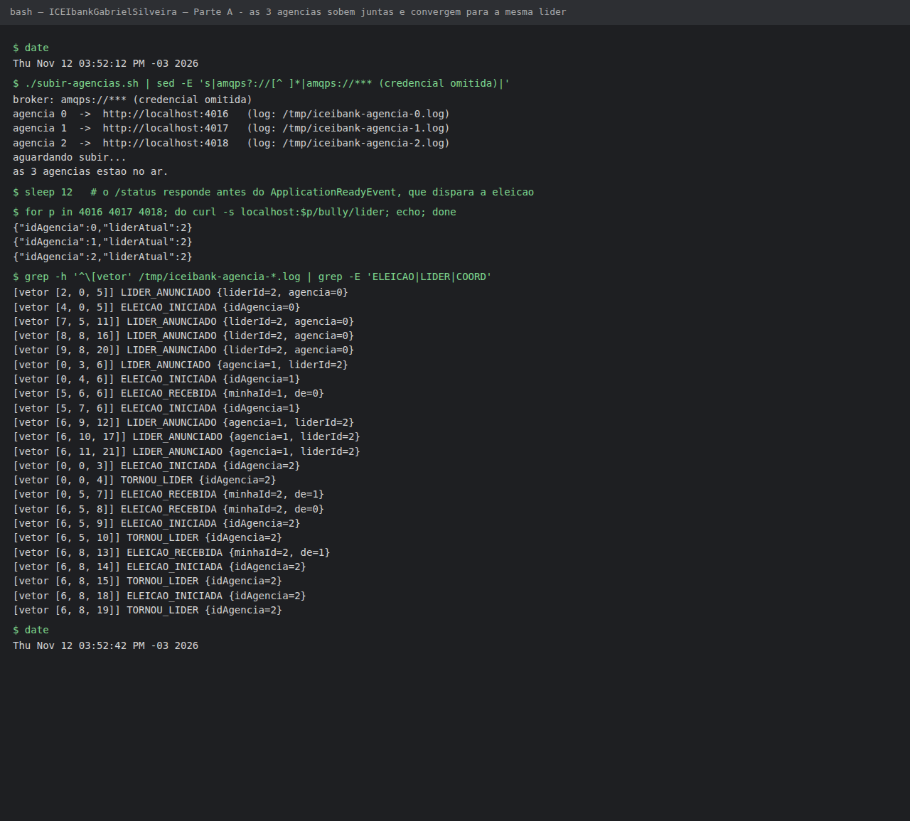

### 5.5.1 — Por que o maior ID, e não o menor? Inverter a regra daria resultado correto?

O maior ID vence por **convenção**. O algoritmo precisa que todos os processos usem o mesmo critério
de desempate para chegar à mesma resposta sem votação, e "maior id" é uma ordem total que cada
agência conhece sozinha, porque sabe o próprio id e o das outras. O nome vem disso: o maior "intimida"
(*bully*) os menores e toma a eleição para si.

Com a regra invertida, o resultado seria **diferente e continuaria correto**. Bastaria trocar
`idAgencia + 1 .. total` por `0 .. idAgencia - 1` no laço de `ServicoBully.iniciarEleicao` e inverter a
comparação em `receberCoordenador`. A líder passaria a ser a agência 0, e as três continuariam
concordando, porque a garantia do algoritmo é a **convergência para um critério comum**, não o valor
do critério. Num sistema real, o id costuma carregar uma prioridade de verdade (máquina mais forte,
réplica mais atualizada), e aí a escolha da direção deixa de ser arbitrária.

### 5.5.2 — Mais de um `TORNOU_LIDER` na subida: bug ou esperado?

**É esperado.** No print acima, a agência 2 declara `TORNOU_LIDER` **quatro vezes** em menos de um
segundo (`[0,0,4]`, `[6,5,10]`, `[6,8,15]`, `[6,8,19]`). Cada `ELEICAO_RECEBIDA` vinda da 0 ou da 1
faz a 2 rodar a própria eleição de novo (passo 4 do algoritmo). Como ninguém acima dela responde, ela
vence de novo e reanuncia. A 0 e a 1 registram um `LIDER_ANUNCIADO {liderId=2}` para cada anúncio,
quatro cada uma.

Nesta execução só a 2 se declarou, porque as três ficaram prontas quase juntas. Uma agência menor
também se declararia se as de id maior ainda não estivessem de pé quando ela perguntasse. Isso
aparece no teste `maiorQueVoltaRetoma` e no failover da Parte B. Não é bug porque **todas as
declarações convergem para o mesmo valor**: depois que a tempestade passa, as três respondem
`liderAtual: 2`. O algoritmo garante o estado final, não um caminho sem redundância.

### 5.5.3 — `/bully/eleicao` sem autenticação é um problema real de segurança?

No roteiro, sim. Por isso **aqui as duas rotas exigem `X-Agencia-Token`**. Sem esse header, quem
achasse a URL poderia:

- **forjar um `/bully/coordenador`** com `liderId=0`. A agência 0 aceitaria, e as maiores recusariam
  (graças à regra de "recusar coordenador menor"), então o sistema ficaria dividido até a próxima
  eleição;
- **disparar eleições em laço.** Cada mensagem gera uma rodada de eleições entre as agências e, com
  isso, **avança o relógio vetorial** de todas. Isso tem um efeito colateral concreto neste projeto:
  todo app com operação offline pendente passaria a receber 409 (ver 9.6.2). Uma eleição forjada vira
  negação de serviço contra a sincronização.

O impacto hoje é limitado porque a líder ainda é **só informativa**: nenhuma operação depende dela.
No Sprint 4 a líder coordena o 2PC, e uma líder forjada passa a decidir commit ou abort.

**O que continua aberto, e fica registrado:** o `X-Agencia-Token` tem um valor padrão commitado no
`application.yml`. Quem lê o repositório consegue forjar um coordenador. Em produção, o segredo viria
só do ambiente e cada agência teria a própria credencial, para a mensagem provar *quem* a enviou, e
não só que "veio de alguma agência". Quanto à entrada, `liderId` e `origemId` fora de `[0, 3)` e
vetores com posição negativa já são recusados com 400 (commit `82ea6c6`).

## Parte B — Heartbeat e failover automático (6.4)

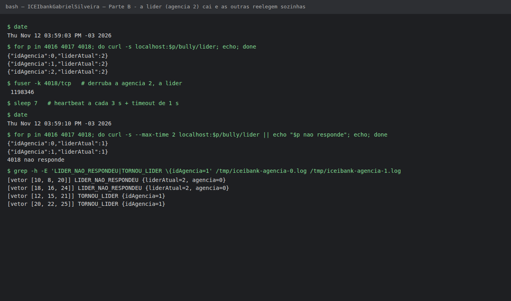

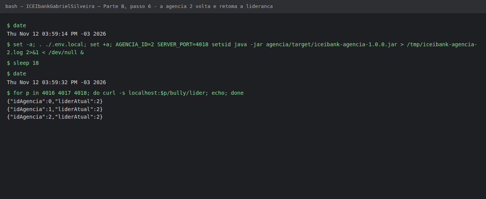

### 6.4.1 — Heartbeat muito curto (100 ms) ou muito longo (60 s)?

O tempo de detecção é cerca de **intervalo + timeout**. No print, a 2 cai às 15:59:03 e às 15:59:10
a 0 e a 1 já respondem `liderAtual: 1`, com intervalo de 3 s e timeout de 1 s.

- **100 ms** detectaria a queda em cerca de 1,1 s, mas cada agência faria 10 GETs por segundo na líder.
  A líder é justamente a agência que mais vai trabalhar no Sprint 4, e esse custo cresce com o número
  de agências. Pior: com intervalo muito menor que o timeout, uma lentidão momentânea vira falso
  positivo com mais frequência, e cada falso positivo dispara uma eleição inteira.
- **60 s** deixaria o sistema até um minuto sem líder depois de uma queda. Hoje isso não aparece
  porque a líder é informativa; no Sprint 4, toda transação distribuída ficaria parada esse tempo.

O intervalo e o timeout **não estão fixos no código**: `BULLY_INTERVALO_MS` e `BULLY_TIMEOUT_MS`
(padrão 3000 e 1000). O trade-off pode ser ajustado sem recompilar.

### 6.4.2 — A agência que volta retoma a liderança. Desejável? Que problema causa?

Aconteceu no passo 6 (print `failover-retorno`): a 2 voltou, convocou eleição ao subir e
retomou a liderança da 1. O histórico da Parte C mostra a sequência inteira, `2 -> 1 -> 2 -> 1 -> 2`.

Isso **não é desejável** num sistema real. A troca não melhora nada (a 1 estava funcionando) e gera
mais uma janela de instabilidade. Se acontecer no meio de uma operação coordenada pela líder, como o
2PC do Sprint 4, a coordenadora antiga perde o papel com uma transação em voo: os participantes que
votaram "sim" ficam bloqueados esperando uma decisão que a nova líder não conhece. Por alguns
instantes, as duas ainda podem se considerar líderes.

A correção usual é **não preemptar**: quem volta e encontra uma líder viva entra como seguidora.
Também se usa um **número de mandato (época)** em cada mensagem, como no Raft, para que ordens de uma
líder antiga sejam recusadas. Mantive o comportamento clássico do Bully porque é o que o roteiro pede
observar.

### 6.4.3 — Rede lenta (resposta acima de 1 s, agência viva): o que acontece?

Uma agência viva passa a ser tratada como morta. Um sistema assíncrono **não consegue distinguir
"lento" de "caído"**: o timeout é um palpite. As consequências aqui:

1. **Duas líderes por um tempo.** A agência 1 pergunta à 2, não recebe resposta em 1 s, conclui que
   está sozinha no topo e se declara líder, enquanto a 2 continua se achando líder.
2. **Liderança oscilando.** Quando o anúncio da 1 chega à 2, a 2 recusa (`COORDENADOR_RECUSADO`) e
   convoca eleição. Se a lentidão persistir, isso se repete a cada heartbeat.
3. **Efeito sobre o offline-first.** Cada uma dessas eleições avança o relógio vetorial das agências,
   e toda operação offline pendente passa a dar 409 (9.6.2). O problema de rede de uma camada vira
   conflito falso em outra.

O timeout precisa ficar acima do p99 de latência real, por isso é configurável. A alternativa mais
robusta é um detector adaptativo (*phi accrual*), que mede o histórico de respostas em vez de usar
um número fixo.

## Parte C — Observando a eleição (7.3)

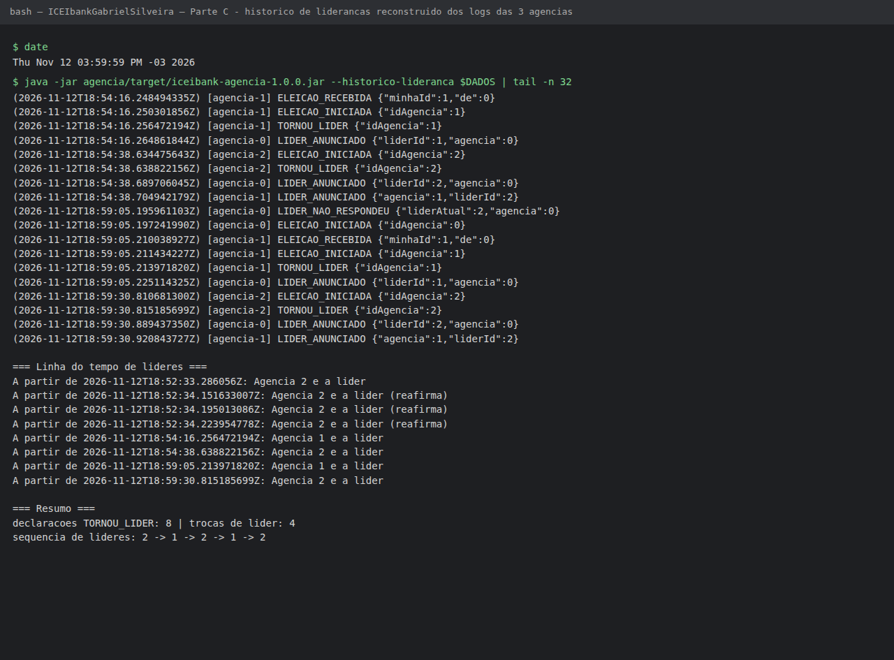

O script é a ferramenta `--historico-lideranca` do próprio jar, equivalente ao
`historico-lideranca.js`. Além do roteiro, ele separa **troca** de **reafirmação**.

### 7.3.1 — Quantas vezes a liderança mudou de mãos na tempestade? Há custo real?

Na subida, a liderança **não mudou de mãos nenhuma vez**. Foram **4 declarações** `TORNOU_LIDER`,
todas da agência 2: uma troca e três reafirmações, entre 18:52:33.286Z e 18:52:34.224Z (UTC; 15:52
no horário de Brasília do `date`). Contar cada
declaração como troca superestimaria a instabilidade. Por isso o script marca as repetidas como
`(reafirma)`, e o resumo da execução inteira dá `declaracoes TORNOU_LIDER: 8 | trocas de lider: 4`.
As 4 trocas são as dos dois failovers e dos dois retornos.

**O custo é real**, mesmo sem afetar o resultado. Contando no log da subida (print da Parte A):

- 7 `ELEICAO_INICIADA` (0: 1, 1: 2, 2: 4) e 4 `ELEICAO_RECEBIDA`;
- 4 `TORNOU_LIDER`, cada um com 2 anúncios: 8 mensagens `/bully/coordenador`;
- cerca de 1 s de rede e CPU nas três agências;
- **o relógio vetorial andou**: a posição da agência 2 foi de 2 (depois de abrir as contas
  iniciais) a 19 só com eleições.

O último item é o que mais pesa neste projeto: qualquer app que tivesse lido a conta antes da
tempestade receberia 409 ao sincronizar. Numa rede de longa distância, com mais agências, o número de
mensagens cresce com o quadrado do número de agências no pior caso.

## Parte D — App Flutter (8.3)

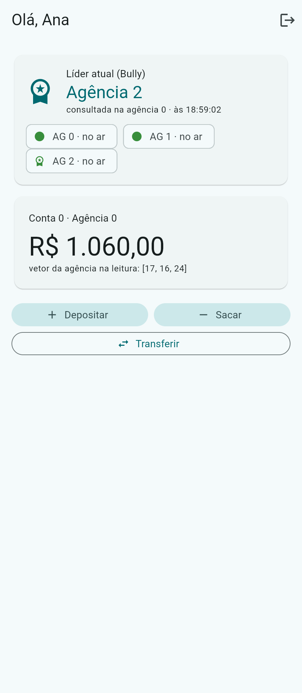

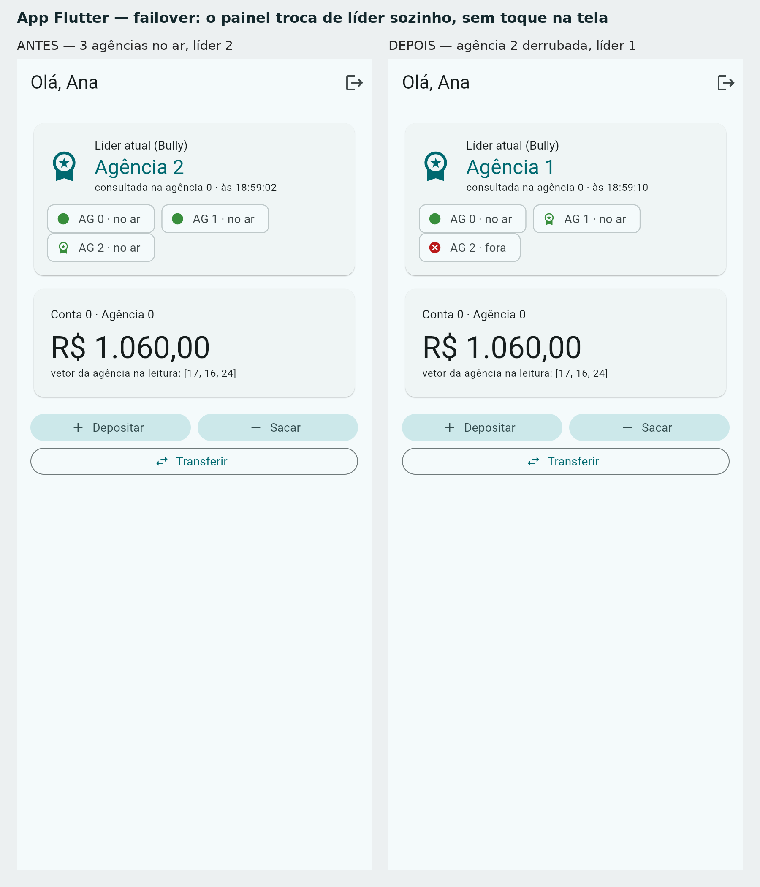

O fluxo bancário completo (login JWT, saldo, depósito, saque, transferência local e entre agências,
erros da API na tela) está coberto por testes de widget em `app_mobile/test/fluxo_bancario_test.dart`:
47 testes no app, todos verdes, e os que rodam no navegador também passam com
`flutter test --platform chrome`.


A transferência acima (conta 0 → conta 1, R$ 25,00) foi feita pela interface contra a pilha do
`docker compose`: a conta 0 foi de R$ 1.000,00 para R$ 975,00 e a conta 1, na agência 1, de
R$ 800,00 para R$ 825,00, com o `TRANSFERENCIA_CREDITO_REMOTO` chegando pela fila. Essa rodada
achou um defeito que os testes na VM não pegavam: a chave de idempotência usava
`Random.nextInt(1 << 32)`, e compilado para JavaScript `1 << 32` vale 0. Toda transferência
falhava no app web antes de sair do aparelho. Corrigido no commit `54fcf7f`.

### 8.3.1 — Com que frequência o app consulta `/bully/lider`? Que trade-off?

A cada **3 s, o mesmo intervalo do heartbeat das agências**. Consultar mais rápido não adiantaria: a
agência só descobre a queda no próximo heartbeat dela, e o app veria a mesma resposta antiga várias
vezes, gastando bateria e dados. Consultar mais devagar faria a troca demorar mais para aparecer. O
atraso máximo no app é o das agências (intervalo + timeout) mais um ciclo do app. No print de
failover, tirado logo depois de o terminal confirmar a nova líder, o painel já mostrava "Agência 1"
sem nenhum toque na tela.

Com a funcionalidade adicional, o app consulta **as 3 agências em paralelo**: são 3 requisições pequenas a cada
3 s, cerca de 1 por segundo. Isso é aceitável em primeiro plano. Uma melhoria que **não fiz** seria
pausar o `Timer` quando o app vai para segundo plano, onde ninguém está olhando o painel.

### 8.3.2 — Duas agências respondem líderes diferentes. Como o app se comporta?

Implementado e testado (`monitor_lideranca_test.dart`, grupo "agências ativas"). O painel mostra a
resposta da agência **preferida**, a última que respondeu, e acrescenta *"As agências ainda não
concordam: troca de liderança em andamento"*. Na consulta seguinte, já convergidas, o aviso some
sozinho (teste `na consulta seguinte, já convergidas, a divergência some sozinha`).

Para **exibir**, não é um problema real: a divergência dura no máximo um heartbeat. Seria um problema
se o app **agisse** com base na líder, por exemplo mandando uma transação para ela no Sprint 4. Aí o
certo seria a agência que recebe a ordem redirecionar para a líder verdadeira, em vez de confiar no
que o celular acha.

### 8.3.3 — O que o app reaproveitou do frontend web, e o que foi diferente?

**Reaproveitado (conceito, não código):**

- um único módulo conhece o JWT e monta o header (`ApiCliente`, como o `modelo/api.js`);
- a conta N é roteada para a agência N % 3 **antes** da requisição;
- a chave de idempotência da transferência é gerada no cliente;
- a mensagem de erro do backend chega à tela sem tradução que esconda o motivo;
- a separação em modelo, estado e telas, o mesmo papel do M/V/C da 12.3.3.

**Diferente por ser mobile:**

- **rede não confiável é o caso normal.** O app distingue `SemConexao` ("a agência nem julgou") de
  `ErroApi` ("a agência recusou"). No web, os dois viravam o mesmo erro; aqui, um entra na fila
  offline e o outro não;
- **persistência local de verdade** (Hive). No web só o token ia para o `localStorage`;
- **o host não é `localhost`**: no emulador, o PC é `10.0.2.2`. Por isso o host é editável no login;
- **ciclo de vida e bateria**: o polling tem custo que o navegador de mesa não cobra;
- **dinheiro em centavos inteiros**: o saldo provisório soma valores, e em `double`
  0,10 + 0,20 não dá 0,30;
- **HTTP sem TLS precisa de permissão explícita** no Android (`usesCleartextTraffic`).

## Parte E — Sincronização offline-first no backend (9.6)

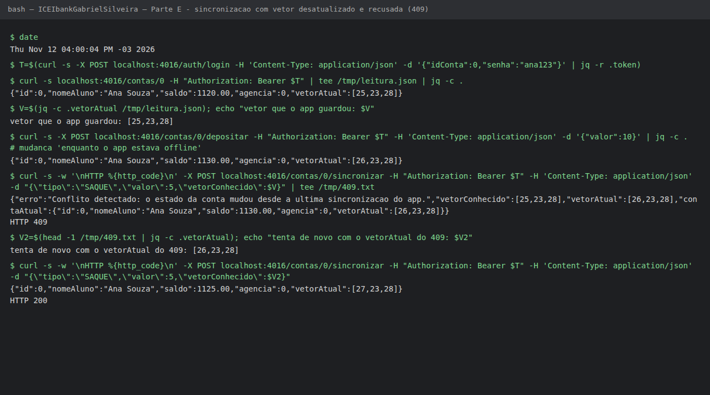

### 9.6.1 — Por que comparar o vetor inteiro, e não só o saldo?

Porque **saldo igual não quer dizer que nada aconteceu.** Um depósito de 10 seguido de um saque de 10
deixa o saldo idêntico, mas houve duas operações que o app não viu. A comparação de saldo diria
"seguro" e a de vetores diz "mudou" (`ANTES`). Esse é o problema ABA.

O vetor também detecta o que o saldo nem consegue expressar: um vetor **CONCORRENTE** ao da agência,
que ela nunca teve (vetor forjado, de outra malha ou de um backup antigo restaurado). O teste
`vetorConcorrenteDaConflito` cobre esse caso. A regra do backend é que **só `IGUAIS` é seguro**.

A comparação e a aplicação acontecem **sob o mesmo lock do relógio**
(`RelogioVetorial.eventoLocalSeAindaFor`). Sem isso, um depósito que entrasse entre "o vetor é igual"
e "aplica" passaria despercebido.

Um efeito colateral útil: reenviar a mesma operação (a resposta se perdeu na rede) dá 409 na
segunda vez, porque a primeira já avançou o vetor. **O vetor faz o papel de chave de idempotência**
(teste `reenvioNaoDuplica`).

### 9.6.2 — Qualquer mudança na agência vira conflito. Por que a simplificação, e como seria por conta?

O relógio vetorial é **da agência**: uma posição por processo, não por conta. Ele avança com
qualquer evento local, como operação em outra conta, mensagem recebida da fila e, neste sprint,
**mensagens do Bully**. Isso aparece no print da Parte A: a agência 0 não fez nenhuma operação
bancária na subida, e mesmo assim a posição dela chegou a 9. Só 2 desses incrementos vieram da
abertura das contas iniciais; os outros 7 vieram da eleição e dos anúncios (`LIDER_ANUNCIADO` aplica
a regra 3 e incrementa). Por isso, na captura dos prints, o app foi
recarregado para reler a conta depois que a agência 2 voltou e houve nova eleição, antes do teste de
modo avião. Sem isso, o depósito offline daria 409 sem ninguém ter mexido na conta.

A simplificação existe porque reaproveita uma estrutura que já estava pronta e testada, e porque erra
para o lado **seguro**: recusa demais, nunca aplica sobre um estado desconhecido.

**Para ser preciso por conta**, a conta precisaria da própria versão: um contador em `Conta`,
incrementado a cada operação **naquela** conta, devolvido no `GET` e comparado no `/sincronizar`. É o
controle de concorrência otimista do HTTP (`ETag` / `If-Match`). O vetor continuaria servindo para
ordenar eventos **entre** agências, que é o papel dele.

### 9.6.3 — No 409, o app descarta, tenta de novo sozinho ou pergunta?

**Pergunta à pessoa.** A Parte F mostra como.

A operação offline foi decidida olhando um saldo que **não é mais o real**. Um saque de 30 sobre
R$ 1.110 pode não fazer sentido se, enquanto o celular estava sem rede, alguém sacou da mesma conta.
Reenviar sozinho tomaria essa decisão no lugar da pessoa, e descartar sozinho jogaria fora uma
intenção dela sem avisar. Por isso o app mostra o saldo real e oferece **"Aplicar mesmo assim"**, que
reenvia com o vetor novo do 409, ou **"Descartar"**.

Uma melhoria possível, que **não implementei**, seria reenviar depósitos automaticamente. Depósito
comuta com qualquer outra operação e nunca deixa a conta negativa. Preferi a regra uniforme.

## Parte F — App Flutter offline-first (10.3)

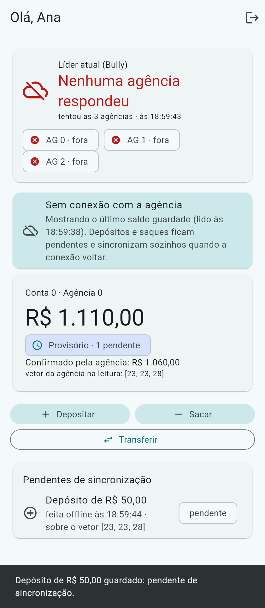

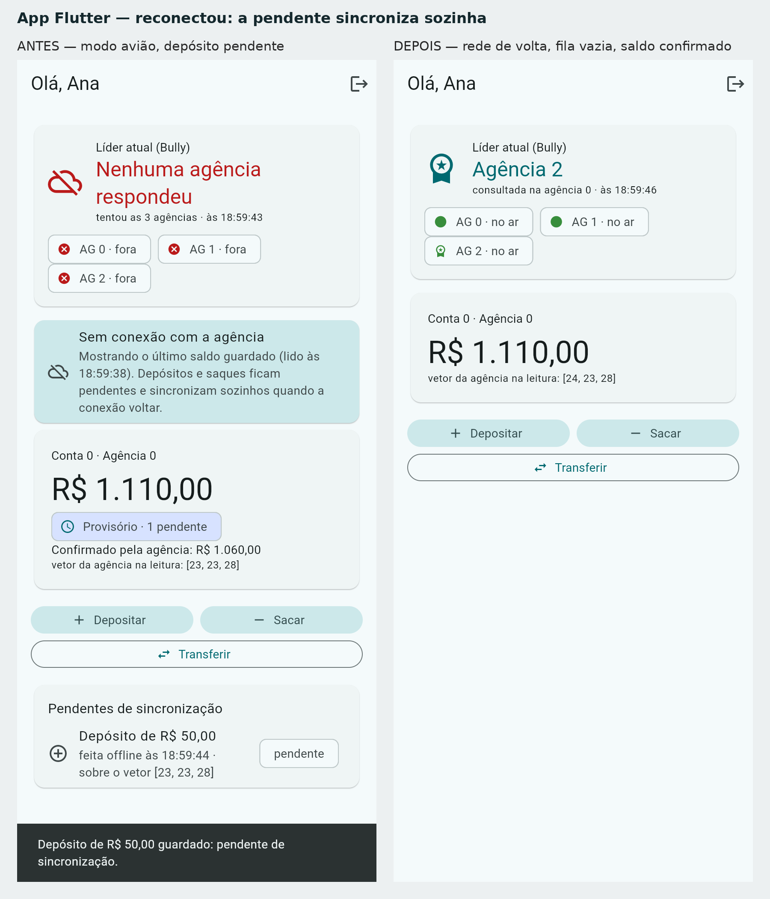

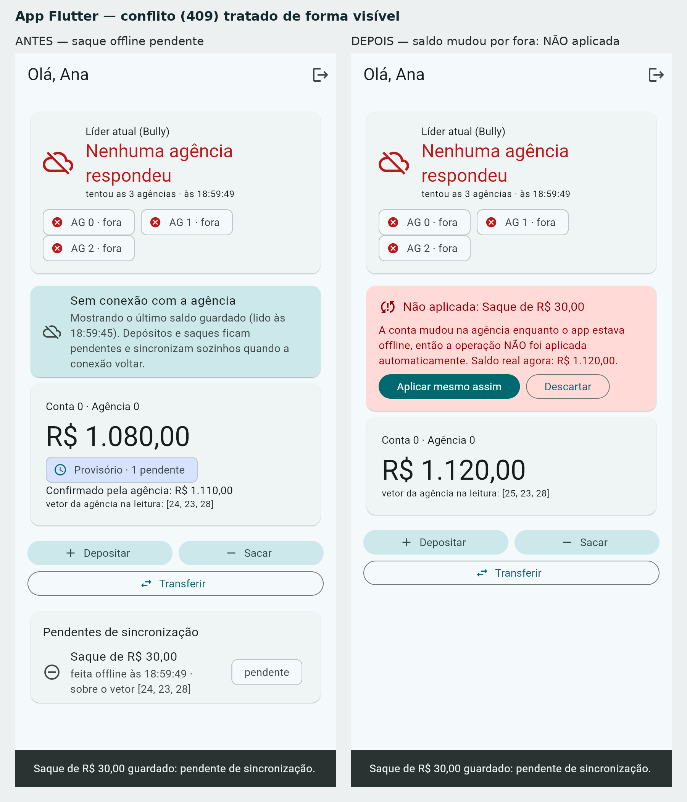

### 10.3.1 — Qual biblioteca de armazenamento local, e por quê?

**Hive, na edição comunitária `hive_ce`.** O dado guardado é pequeno e sem relações: a última
leitura de cada conta (saldo e vetor juntos), uma fila de operações e a sessão. Não há consulta a
fazer, então SQL seria peso morto. Hive grava mapas direto, sem gerador de código, e roda igual no
Android, na web e no `flutter test` sem banco nativo. Os testes da fila usam o mesmo armazenamento,
até a reabertura do app offline (teste `reabrir o app offline restaura sessão, saldo e fila do disco`).

Alternativas consideradas:

- **sqflite**: SQL de verdade, mas nativo. Para rodar no `flutter test` e na web precisaria do
  `sqflite_common_ffi`, e eu não tinha consulta que justificasse isso.
- **Drift**: SQL tipado e reativo, ótimo para modelo relacional, mas depende de geração de código.
  Seria exagero para três caixas.
- **Hive original**: preferi a `hive_ce` porque o pacote original está sem manutenção ativa.

### 10.3.2 — O que apareceu na tela quando a sincronização foi recusada? Por quê?

No print da tarefa 5:

1. Com o app offline, fiz um saque de R$ 30,00. Ele entrou como pendente, e o saldo provisório foi
   para R$ 1.080,00, com "Confirmado pela agência: R$ 1.110,00" logo abaixo.
2. Ainda offline, depositei R$ 10,00 na mesma conta por fora, via `curl`.
3. Ao reconectar, o app sincronizou sozinho e a agência respondeu 409.

A tela passou a mostrar um **cartão vermelho** no topo: *"Não aplicada: Saque de R$ 30,00 — A conta
mudou na agência enquanto o app estava offline, então a operação NÃO foi aplicada automaticamente.
Saldo real agora: R$ 1.120,00"*, com os botões **Aplicar mesmo assim** e **Descartar**. O saldo
grande passou a ser o real, R$ 1.120,00. A operação recusada **sai do saldo provisório**, porque a
agência já disse que não a aplicou.

Escolhi assim pelo que está em 9.6.3: a decisão é da pessoa. O roteiro pede que o conflito não seja
silencioso, e um aviso discreto que some sozinho seria exatamente isso. O cartão fica na tela até a
pessoa escolher.

### 10.3.3 — Que risco a UI otimista traz num app bancário? Como o design reduz?

O risco é **mostrar dinheiro que pode não existir.** A pessoa vê R$ 1.110,00, age com base nesse
número (paga alguém, promete um valor) e depois a sincronização é recusada. Num app de notas, isso é
um rascunho perdido; num banco, é uma decisão financeira tomada sobre um número falso.

O que o design faz para reduzir:

- **o provisório nunca aparece sozinho**: vem o chip "Provisório · N pendente(s)" e, logo abaixo, o
  saldo confirmado pela agência;
- **saque offline limitado ao saldo provisório**: a UI otimista nunca mostra saldo negativo;
- **transferência offline é recusada** com mensagem clara: ela mexe em duas contas, possivelmente em
  duas agências, e o backend não sincroniza transferências;
- **a fila entra em ordem e é persistida**: fechar o app não perde nada;
- **o backend só aplica sobre o estado que o app viu** (vetor `IGUAIS`). O otimismo é na tela, não
  no dinheiro;
- **operações seguidas não conflitam consigo mesmas**: quando a primeira pendente é aplicada, as
  seguintes passam a carregar o vetor novo (teste `várias operações offline seguidas...`);
- **com fila não vazia, a operação nova vai para o fim da fila mesmo online**, porque aplicar direto
  avançaria o vetor e faria as pendentes darem 409.

**Gatilho de sincronização:** o `connectivity_plus` avisa quando a rede volta, mas sabe só se o
*aparelho* tem rede, não se a *agência* responde. Por isso há também um timer de 5 s enquanto houver
pendente ou o app estiver offline. Com Wi-Fi ligado e a agência derrubada, nenhum evento de
conectividade chega quando ela volta (teste `aparelho com rede mas agência fora: o timer tenta de
novo`).

## Funcionalidade adicional do Sprint 3 — agências ativas

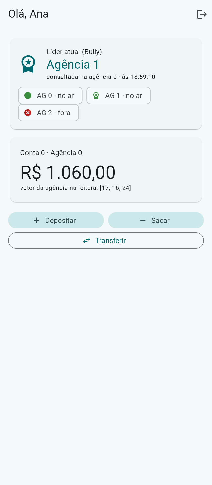

Opção da seção 2.1: **indicador de agências ativas.** Além da líder, o painel mostra `AG 0 · no ar`,
`AG 1 · no ar`, `AG 2 · fora`, com a coroa na líder.

O app passou a consultar **as 3 agências em paralelo** a cada ciclo. O mapa de quem responde sai de
graça, e o fallback deixa de somar timeouts: com a 0 fora, a resposta da 1 já está pronta quando o
timeout da 0 estoura. O custo são 3 requisições por ciclo em vez de 1 (8.3.1). A mesma consulta torna
a divergência visível (8.3.2).

O indicador diz que a agência **respondeu ao app**, não que ela esteja saudável para as outras
agências. São perguntas diferentes, e numa partição de rede as respostas podem divergir. Commit
próprio: `b1d87ae`.


## Índice de evidências

Os 18 prints de `evidencias/sprint1/`, e o que cada um prova. Todos saíram da **mesma
execução** de 13–14/09/2026, com as três agências no mesmo host — por isso os carimbos de
Lamport são contínuos entre eles.

### Execução e particionamento

| Print | O que prova |
|---|---|
| `print2.png` | As **três agências** subindo: o *mesmo* `iceibank-agencia-1.0.0.jar` em 4016, 4017 e 4018, cada uma carregando as 2 contas da própria partição (12-Factor III) |
| `print3.png` | Três PIDs do mesmo jar + `GET /status` das três: `totalDeAgencias:3`, `contas:2`, `eventos:2`, `relogioLamport:2` em cada uma |
| `particao-recusa.png` | A regra `id % 3` recusando: conta 1 na agência 0 → **HTTP 400**; a mesma conta 1 na agência 1 → **HTTP 200** |

### Parte B — Relógio de Lamport

| Print | O que prova |
|---|---|
| `transferencia-local.png` | Transferência local (0 → 3, R$ 100): dois `eventoLocal()`, carimbos **3** e **4**, mesma `horaParede`, sem envio/recebimento |
| `transferencia-entre-agencias.png` | Transferência entre agências (0 → 1, R$ 50): débito **7** na agência 0, crédito remoto **9** na agência 1 — `max(2, 8) + 1` |

### Parte D — Transferências e a falha conhecida

| Print | O que prova |
|---|---|
| `falha-conhecida.png` | A falha **exigida pelo roteiro**: saldo R$ 750,00, agência 1 derrubada, transferência de R$ 20 → **HTTP 502**, saldo R$ 730,00. `TRANSFERENCIA_DEBITO` Lamport 9 e `TRANSFERENCIA_FALHOU` Lamport 11 com `saldoOrigemAposDebito: 730.00` |

### Parte E — Linha do tempo unificada

| Print | O que prova |
|---|---|
| `linha-do-tempo-part1.png` | Saída de `--mesclar-logs`: 14 eventos, 3 agências, **3 timestamps empatados** |
| `linha-do-tempo-part2.png` | A análise dos três empates (Lamport 1, 2 e 9) e a conclusão sobre `A → B ⟹ ts(A) < ts(B)` não valer na volta |
| `linha-do-tempo-front.png` | A mesma linha do tempo na interface, com a coluna `L` (carimbo), a agência de origem e os empates destacados |

### Parte F — Autenticação JWT

| Print | O que prova |
|---|---|
| `print1.png` | `POST /auth/login` devolvendo o JWT (`eyJhbGciOiJIUzI1NiJ9...` — o header já denuncia o **HS256**) |
| `sem-token.png` | Rota protegida sem header → **HTTP 401**, `token ausente: envie Authorization: Bearer <token>` |
| `com-token.png` | A mesma rota com `Authorization: Bearer` → **HTTP 200**, `expiraEmSegundos: 900` |

### Parte G — Frontend

| Print | O que prova |
|---|---|
| `frontend-1.png` | A aplicação rodando em `localhost:5173`: painel da conta 0, seletor das 3 agências, contador `Lamport 13`, `token 896s`, botão *Expirar token*, e o DevTools mostrando as chamadas autenticadas |
| `saque-acerto.png` | Saque pela interface: *Saque efetuado — novo saldo da conta 0: R$ 180* |
| `saque-erro.png` | Saque inválido: **HTTP 400** traduzido na tela como *Requisição inválida — saldo insuficiente: saldo=200.00, valor=800* |
| `tranfarencia-front.png` | Transferência concluída com **rota calculada** antes do envio (*local — destino na própria agência 0*) e `IDEMPOTENCY-KEY` preenchida |
| `treanfarencia-erro.png` | Transferência recusada: **HTTP 400** com *saldo insuficiente: saldo=200.00, valor=20000* — o erro do domínio chega íntegro na tela |

### Funcionalidades adicionais

| Print | O que prova |
|---|---|
| `historico-conta.png` | As **três** de uma vez: *EXTRA 1* histórico da conta 0 (Lamport 11 → 5); *EXTRA 2* idempotência (`reenvio: false` → `reenvio: true` sem debitar de novo, e **409** para a mesma chave com outro valor); *EXTRA 3* extrato consolidado `total: 970.00` com `consistente: true` |


### Sprint 2 — RabbitMQ e relógio vetorial

Os prints de `evidencias/sprint2/`. A execução é a de **28/09/2026**, com a pilha em
container (`docker compose up --build`) — por isso os carimbos aqui são **vetoriais**,
não mais um inteiro de Lamport.

| Print | O que prova |
|---|---|
| `transferencia-assincrona.png` | Transferência entre agências completando via fila: o débito na origem, o `TRANSFERENCIA_CREDITO_REMOTO` no destino, e o carimbo do destino absorvendo o vetor da origem pela regra 3 (ex.: destino em `[0,3,0]` recebe `[4,0,0]` → grava `[4,4,0]`) |
| `resiliencia-fila.png` | O cenário 7.5.1 inteiro: agência 1 derrubada, transferência publicada com **HTTP 200** e `fila-agencia-1 messages=1 consumers=0`; agência 1 volta, consome, e `945 + 855 = 1800` fecha com o estado inicial |
| `linha-do-tempo-causal.png` | A saída do `--mesclar-logs`: `eventos: 22 | agencias: 3 | pares concorrentes: 123`, com ao menos um par concorrente entre agências diferentes na lista, e a ausência do par causal débito→crédito |
| `deduplicacao.png` | A funcionalidade adicional: a mesma mensagem reentregue, o saldo creditado **uma vez só**, e o `CREDITO_REMOTO_DUPLICADO` registrado na segunda entrega |

### Sprint 3 — Eleição de líder e app Flutter

Os prints de `evidencias/sprint3/`, da execução de **12/11/2026, 15:50–16:00**. Os de terminal saíram
de um shell **bash no Linux**, não do PowerShell: o `date` no topo e no fim de cada um faz o papel do
`Get-Date`. Os do app são do build web do Flutter rodando no Chromium, com o modo offline do
navegador no lugar do modo avião. Foram capturados por script (`date` e comandos visíveis no
próprio print), contra as agências reais em execução.

| Print | O que prova |
|---|---|
| `eleicao-inicial.png` | As 3 agências sobem juntas e as 3 respondem `liderAtual: 2`; no log, a tempestade: 7 eleições iniciadas, 4 `TORNOU_LIDER` da agência 2, 8 anúncios recebidos |
| `failover.png` | Às 15:59:03 a líder 2 é derrubada; às 15:59:10 a 0 e a 1 respondem `liderAtual: 1`, a 4018 não responde, e o log mostra `LIDER_NAO_RESPONDEU` e o `TORNOU_LIDER` da 1 |
| `failover-retorno.png` | Passo 6 da Parte B: a agência 2 volta e as 3 voltam a responder `liderAtual: 2` |
| `historico-lideranca.png` | `--historico-lideranca`: a linha do tempo `2 -> 1 -> 2 -> 1 -> 2`, com as reafirmações da subida separadas das trocas |
| `app-lider-atual.png` | O app mostrando a líder (Agência 2) e as 3 agências no ar |
| `app-failover.png` | Antes e depois: a líder 2 derrubada e o painel trocando para a Agência 1 sozinho, com `AG 2 · fora` |
| `conflito-sincronizacao.png` | `POST /contas/0/sincronizar` com o vetor de antes de um depósito → **409** com `vetorConhecido`, `vetorAtual` e `contaAtual`; repetido com o `vetorAtual` do 409 → **200** |
| `app-offline.png` | Modo avião: aviso de offline, depósito de R$ 50,00 como pendente, saldo provisório R$ 1.110,00 e confirmado R$ 1.060,00 |
| `app-sincronizacao.png` | Antes e depois: a rede volta e a pendente sincroniza sozinha; fila vazia, saldo confirmado R$ 1.110,00 |
| `app-conflito-409.png` | Tarefa 5 da Parte F: saque offline, depósito por fora, reconexão, e o cartão vermelho "Não aplicada" com o saldo real e as duas escolhas |
| `app-transferencia.png` | Transferência 0 → 1 de R$ 25,00 pelo app, contra a pilha em container: recibo *"Transferencia publicada para a agencia 1"* e saldo R$ 975,00 |
| `agencias-ativas.png` | Funcionalidade adicional: `AG 0 · no ar`, `AG 1 · no ar`, `AG 2 · fora`, com a coroa na líder 1 |

---

## Declaração de uso de IA — Sprint 1

Eu, **gabriel silveira**, RA **1466316**, declaro que utilizei o Claude (Anthropic) como
ferramenta de apoio ao longo deste sprint, nos termos abaixo.

- **Explicação conceitual e revisão socrática** na primeira metade: o relógio de Lamport, o particionamento e o modelo (`Conta`, `Particionador`, `RelogioLamport`) foram escritos por mim, com a IA revisando cada ciclo de TDD e explicando os erros — o bug de fronteira no `Particionador` (`> 1` onde devia ser `> 0`), a condição de corrida no contador e a armadilha de imutabilidade do `BigDecimal`.
- **Geração de código sob orientação** na segunda metade (camada web, transferências, JWT, frontend), por restrição de prazo, seguindo decisões que eu havia tomado antes: filtro JWT à mão em vez de Spring Security, carimbo opaco em vez de `int`, falha da Parte D registrada em vez de escondida.
- **Revisão crítica da entrega**, que produziu duas correções reais: o algoritmo do JWT saindo em HS384 sem ninguém saber (11.3.3) e o alcance do problema de autorização, que é entre agências e não apenas dentro de uma (11.3.1).
- **Revisão de texto** deste documento.

Sou capaz de explicar e defender qualquer trecho entregue. As decisões registradas aqui — por que o carimbo não implementa `Comparable`, por que a chamada entre agências não carrega JWT de usuário, por que a falha da Parte D não é revertida, por que as portas de uma implementação só foram removidas — foram decididas por mim antes de virarem código.

**Limitação documentada por escolha própria:** a implementação verifica autenticação mas não autorização por recurso (11.3.1). Optei por registrar em vez de omitir.

Declaro que o conteúdo entregue é de minha autoria e responsabilidade, e que o uso da
ferramenta está descrito acima sem omissão.

**gabriel silveira** — RA 1466316 — PUC Minas / ICEI

---

## Declaração de uso de IA — Sprint 2

Eu, **gabriel silveira**, RA **1466316**, declaro que no Sprint 2 utilizei o Claude (Anthropic) como ferramenta de apoio, nos termos abaixo.

- **Implementação sob orientação, sempre em TDD.** O relógio vetorial, o consumidor de mensagens, a análise causal e a deduplicação foram construídos com teste vermelho antes do verde — a IA escreveu código seguindo decisões que eu havia tomado antes: o carimbo guardando `List<Integer>` e não `int[]`, a ausência de `Comparable`, a remoção da pré-checagem síncrona do destino, a mensagem carregando o vetor inteiro (regra 2).
- **Verificação ao vivo, não presumida.** As afirmações deste documento sobre o Sprint 2 foram medidas contra a pilha em execução: o cenário de resiliência (7.5.1) foi reproduzido derrubando e subindo a agência 1 de verdade; a fila retendo a mensagem foi lida no painel do broker; a limitação de segurança da mensageria (7.5.3) foi confirmada por execução, não deduzida.
- **Revisão crítica**, que apontou a fragilidade da autenticação da mensageria descrita em 7.5.3 — a fronteira de confiança que passou do filtro HTTP para o broker sem defesa equivalente.
- **Revisão de texto** deste documento.

Sou capaz de explicar e defender qualquer trecho entregue no Sprint 2 — em particular por que o vetorial substituiu Lamport e a interface `sealed` saiu junto, por que o consumidor não exige JWT, por que a falha encolheu e mudou de lugar (do 502 síncrono para o 503 de broker fora do ar), e por que a deduplicação corrige uma incorreção real da entrega *at-least-once*.

**Limitação documentada por escolha própria:** a autenticação da mensageria, no ambiente de desenvolvimento, ainda está nos defaults do broker (7.5.3). Optei por registrar, com evidência, em vez de omitir.

Declaro que o conteúdo entregue é de minha autoria e responsabilidade, e que o uso da ferramenta está descrito acima sem omissão.

**gabriel silveira** — RA 1466316 — PUC Minas / ICEI
